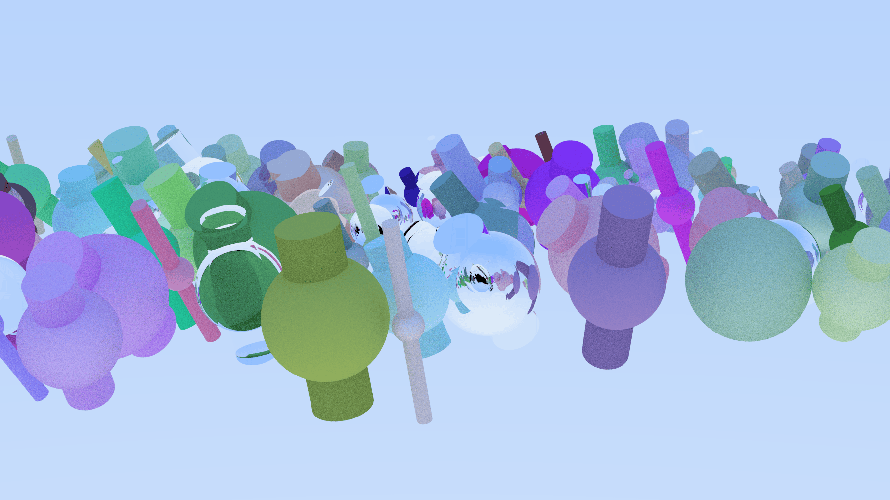

Renderizador de escenas 3D desarrollado en C++ mediante ray tracing.

El programa carga una configuración y una escena, calcula la imagen usando renderizado paralelo con TBB y la guarda en formato PPM. La imagen se almacena con una representación **Structure of Arrays (SoA)**.

## Requisitos

- CMake 4.0 o superior
- Compilador compatible con C++20
- Intel oneTBB
- Conexión a Internet durante la primera configuración, para descargar GSL y GoogleTest

## Compilación

```bash
cmake -S . -B build
cmake --build build
```

También se pueden utilizar los presets disponibles en `CMakePresets.json`.

## Uso

El ejecutable recibe un archivo de configuración, un archivo de escena y la ruta de la imagen de salida:

```bash
./build/par/render-par <config_file> <scene_file> <output_image>
```

Por ejemplo:

```bash
./build/par/render-par test/config.txt test/scene.txt test/resultado.ppm
```

Los archivos de configuración permiten ajustar la cámara, la resolución, el número de muestras por píxel, la profundidad máxima y las semillas aleatorias. Los archivos de escena definen materiales y objetos geométricos, como esferas y cilindros.



## Pruebas

Para ejecutar las pruebas unitarias:

```bash
ctest --test-dir build --output-on-failure
```

Las pruebas cubren la configuración, vectores, cámara, materiales, escenas, objetos geométricos, imágenes y renderizado paralelo.
